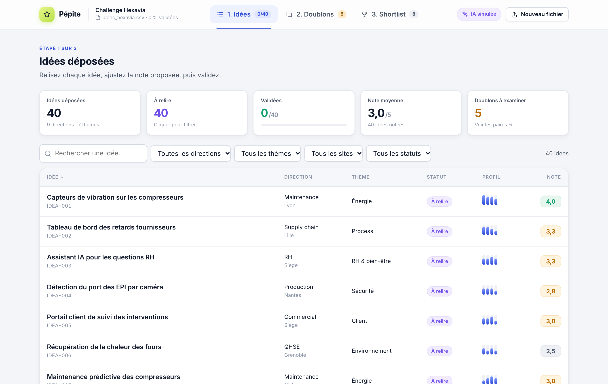
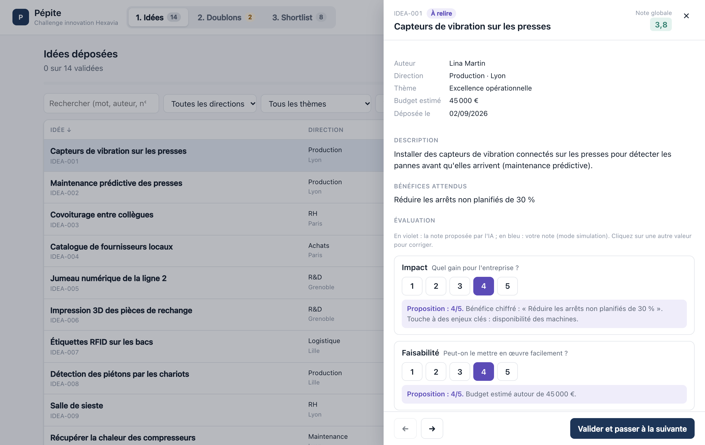
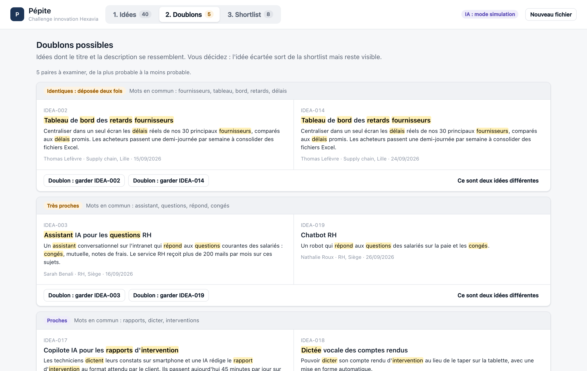
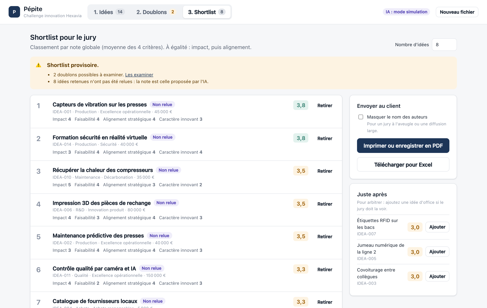

# Pépite : le tri des idées du challenge Hexavia

## Aperçu

**Application en ligne : https://hexavia-idees.vercel.app** · CI : 

Camille importe l'export du formulaire, relit une note proposée pour chaque idée, tranche les doublons et envoie la shortlist au client.

| Idées et filtres | Notation (proposition + correction) |
|---|---|
|  |  |
| **Doublons côte à côte** | **Shortlist prête à envoyer** |
|  |  |

> Captures réalisées sur l'export fourni (`idees_hexavia.csv`, données fictives). `npm run screenshots -- idees_hexavia.csv docs` les régénère, avec `npm run preview` lancé.

## Lancer l'outil

```bash
npm install
npm run dev          # http://localhost:5173 : déposer idees_hexavia.csv
npm test             # 80 tests unitaires (Vitest)
npm run test:e2e     # parcours complet dans un vrai navigateur (Playwright)
```

Node 20 ou plus récent. Aucune variable d'environnement n'est nécessaire : l'IA tourne en mode simulation par défaut.

## 1. Cadrage

**Le besoin.** Camille doit présenter environ 8 idées à un jury dans dix jours, sur 40 déposées. Aujourd'hui elle les dépouille dans Excel : c'est long, et ses notes manquent de cohérence d'une idée à l'autre. Il lui faut un seul endroit pour lire et filtrer les idées, une première note sur la grille du client (avec une justification qu'elle corrige), le repérage des doublons, puis une shortlist présentable au client.

**Utilisateurs.** Camille, consultante non technique, seule sur son ordinateur. Indirectement, le client et le jury, qui reçoivent la shortlist. Plus tard, d'autres consultants INSKIP sur d'autres challenges.

**Mes hypothèses** (je n'ai pas pu interroger Camille) :
- Les quatre critères pèsent autant, et la note globale est leur moyenne. Les poids se règlent dans [`src/domain/config.ts`](src/domain/config.ts).
- La stratégie d'Hexavia n'est pas fournie. Pour le critère « alignement », je retiens cinq axes typiques d'un industriel : décarbonation, sécurité, excellence opérationnelle, numérique, satisfaction client.
- L'IA **propose** et Camille **décide** : une note qu'elle saisit n'est jamais écrasée.
- Un doublon est écarté de la shortlist mais reste visible. Chaque décision peut être annulée.
- La shortlist part chez le client en PDF (impression du navigateur) ou dans Excel. Les noms des auteurs peuvent être masqués.
- Une seule personne note à la fois, sur un seul poste. Pas besoin de comptes pour la V1.
- L'export est imparfait : dates et budgets saisis librement, champs vides, idée déposée deux fois, idée en anglais. Rien n'est supprimé : tout est signalé à l'import, et c'est Camille qui tranche.
- L'idée en anglais (IDEA-021) est notée comme les autres ; à elle de décider s'il faut la faire traduire pour le jury.

**Dans la V1 :** import robuste avec rapport des corrections · liste filtrable (direction, thème, site, statut, recherche) · note proposée et justifiée pour chaque critère, corrigeable d'un clic · validation idée par idée avec avancement · doublons présentés par paires avec les mots communs surlignés · shortlist classée, avec ajout ou retrait manuel et réserve · export PDF et Excel · sauvegarde automatique dans le navigateur.

**Plus tard :** vrai modèle branché par défaut (le code est prêt, voir § 5) · comptes et notation à plusieurs (moyenne des évaluateurs, écarts entre eux) · grille et axes modifiables dans l'interface pour chaque client · base de données partagée (Supabase) · export PowerPoint du jury.

## 2. Conception

```
Navigateur (React)                                   Vercel
┌───────────────────────────────────────────┐        ┌──────────────────────────────┐
│ components/  écrans, aucune logique métier│        │ api/score.ts (optionnel)     │
│ state/       état + sauvegarde locale     │ ─────▶ │ clé ANTHROPIC_API_KEY ici    │
│ ai/          simulation | appel /api/score│ POST   │ seulement ; sans clé → 503   │
│ domain/      fonctions pures + tests      │ sans   └──────────────────────────────┘
│   csv · normalize · scoring · duplicates  │ nom
│   shortlist · export · config             │
└───────────────────────────────────────────┘
```

**Modèle de données** ([`src/domain/types.ts`](src/domain/types.ts)) :
- `Idea` : les colonnes nettoyées, plus `dateDepot` (ISO) et `budgetEur` (nombre). La valeur saisie d'origine est conservée pour l'affichage.
- `Evaluation` : `ai` (notes, justifications, source simulation ou Claude) et `manuelles` (notes de Camille) restent **séparées**. La note retenue vaut `manuelle ?? ia`, et on voit toujours ce que Camille a modifié.
- `ChallengeConfig` : client, critères avec leurs poids, axes stratégiques, taille de la shortlist. C'est le seul point à changer pour un autre client.
- Décisions : `doublonDe` (idée écartée vers idée gardée), `forcees` (retenue ou retirée à la main).

**Choix et raisons :**

| Choix | Raison |
|---|---|
| React + TypeScript + Vite | La stack d'INSKIP : l'équipe peut reprendre le code. |
| Pas de base de données en V1, sauvegarde dans le navigateur | Une seule utilisatrice. Surtout, les données personnelles (noms des salariés) ne quittent jamais son ordinateur. Supabase devient utile dès qu'on note à plusieurs. |
| Logique métier en fonctions pures dans `domain/` | Testable sans navigateur. Réutilisable telle quelle côté serveur (`api/score.ts` utilise le même prompt et le même schéma). |
| Doublons par TF-IDF et similarité cosinus | Explicable (on montre les mots communs), déterministe, instantané, sans clé. Le TF-IDF ignore les mots présents partout (« production », « site »). Camille garde la décision. |
| Simulation de l'IA par règles déterministes | Le brief interdit la clé. La simulation renvoie **le même format** que le vrai modèle, validé par le même schéma Zod. Passer au modèle réel ne change rien en aval. |
| Fonction serveur pour le vrai modèle | Une clé dans une variable `VITE_*` serait publiée dans le code du navigateur. |
| Export par l'impression du navigateur + CSV | Aucune dépendance pour le PDF, mise en page dédiée (`@media print`). CSV avec BOM et `;` pour Excel en français. |
| Interface : barre de navigation des 3 étapes, indicateurs, panneau de notation | Camille voit à tout moment où elle en est (avancement, doublons restants, taille de la shortlist). Le bouton « Valider » suit directement le commentaire, dans l'ordre de lecture. Icônes en SVG inline et CSS sans bibliothèque : rien à maintenir. Animations courtes, désactivées si le système le demande (`prefers-reduced-motion`). Confirmations avec « Annuler » pour chaque décision. |
| Dépendances | `papaparse` (CSV avec guillemets et retours à la ligne), `zod` (validation des réponses du modèle), `@anthropic-ai/sdk` (côté serveur seulement). |

## 3. Construction avec l'IA

**Assistant :** Claude Code (Claude Opus 5.5). Ses règles sont dans [`CLAUDE.md`](CLAUDE.md), écrit en premier : logique dans `domain/` avec tests, aucun secret, aucun nom envoyé à l'IA, interface en français sans jargon, ne jamais écraser une note de Camille.

**Méthode :** un module par commit, chacun avec ses tests (import → doublons → notation → export → IA → interface → CI). Je relis chaque diff et je lance tests et build avant chaque commit. L'interface est vérifiée sur captures d'écran (bureau, mobile, impression), pas seulement par les tests.

**Prompts les plus utiles :**
1. *« Voici le brief complet et le format du CSV. Les données sont imparfaites comme un vrai export : écris d'abord un fichier de test qui contient tous les pièges réalistes (BOM, `;` dans un champ entre guillemets, retour à la ligne, casse différente, ligne vide, id manquant, id en double, date impossible, budget en texte libre), puis le parseur qui le passe. »*
2. *« La simulation de l'IA doit renvoyer exactement le format du vrai modèle, validé par le même schéma Zod, et chaque justification doit citer un élément concret de l'idée. »*
3. *« Écris un test qui prouve que le prompt envoyé au modèle ne contient ni le nom ni le prénom de l'auteur. »*
4. *« Écris le test de bout en bout du parcours de Camille : mauvais fichier, import, filtre, proposition, correction, validation, doublon, export, rechargement. »*
5. *« Prends des captures de chaque écran et relis-les comme si tu étais Camille. »*

**Quand l'IA s'est trompée :**
- **Fonction serveur en panne une fois en ligne.** Les tests passaient, mais `/api/score` répondait 500 sur Vercel : le projet est en modules ES et Node exige l'extension des fichiers importés (`./scoring.js`), que Vite ajoutait tout seul en local. Repéré en interrogeant l'URL après le déploiement. Correction : extensions explicites, vérifiées en recompilant la fonction comme le fait Node.
- **Panneau enfermé dans la page.** Après la refonte, le panneau de notation ne couvrait plus l'écran et passait sous la barre de navigation. Cause : l'animation d'entrée de la page utilisait une transformation CSS, ce qui fait de la page le repère des éléments `position: fixed`. Repéré sur capture, pas par les tests. Correction : le panneau est rendu directement dans `<body>` (portail React) et l'animation de la page ne joue plus que sur l'opacité.
- **Mots-clés cherchés au milieu des mots, révélé par l'export réel.** Les tests passaient sur mes données d'exemple. Sur le vrai fichier, « Programme ambassadeurs clients » obtenait un bon alignement stratégique : le mot-clé `eau` (décarbonation) était trouvé dans « nouv**eau**x », et `commande` dans « re**commande**r ». « Nouveaux clients » comptait aussi comme un signe d'innovation. Correction : recherche en début de mot, et un test pour chacun de ces cas. Leçon : tester sur la vraie donnée avant de faire confiance aux notes.
- **Doublons manqués à cause du vocabulaire.** « Chatbot RH » et « Assistant IA pour les questions RH » (score 0,21), ou « dictée des comptes rendus » et « copilote IA pour les rapports » (non détectés), sont les mêmes idées formulées autrement. Correction : une petite table de synonymes métier. Le seuil a ensuite été réglé sur le fichier réel.
- **Justifications illisibles, repérées à l'écran.** Tous les tests passaient, mais la capture du panneau affichait « Touche à des enjeux clés (panne, arret) » : les mots-clés internes, sans accents. Même défaut dans « mots en commun : predictive, connectes ». Correction : des libellés lisibles pour les enjeux, et l'affichage des mots communs à partir du texte d'origine, avec un test qui exige « prédictive ». C'est la raison de l'étape « relire les captures ».
- **Espaces insécables.** Le test attendait `2 000 000`, mais `Intl.NumberFormat('fr-FR')` insère des espaces fines insécables (U+202F). Le test a été corrigé, et l'export CSV remplace ces espaces, qui s'affichent mal dans certains Excel.
- **Test de bout en bout faux, application juste.** Le test cliquait « 5 » pour modifier une note, mais l'IA avait déjà proposé 5 : aucune modification. J'ai vérifié que le comportement de l'application était voulu avant de corriger le test, et pas l'inverse.

## 4. Fiabilisation

**80 tests unitaires** (Vitest) sur la logique qui compte :
- **Import** ([`import.test.ts`](src/domain/import.test.ts)) : encodages UTF-8 et Windows-1252, BOM, séparateur, en-têtes avec accents, champs sur plusieurs lignes, lignes vides, identifiants manquants ou en double, harmonisation des directions et thèmes, 7 formats de date, 15 formats de budget, messages d'erreur.
- **Notation** ([`scoring.test.ts`](src/domain/scoring.test.ts)) : refus d'une réponse de modèle invalide (note hors grille ou décimale, critère manquant, texte libre), priorité de la note de Camille, moyenne pondérée, simulation déterministe et cohérente, **aucun nom dans le prompt**, règles de la shortlist (départage, doublons exclus, ajout forcé sans dépasser la taille).
- **Doublons** ([`duplicates.test.ts`](src/domain/duplicates.test.ts)) : idées reformulées rapprochées (synonymes compris), idées sans rapport séparées, idée déposée deux fois marquée « identique », mots communs explicatifs, regroupement transitif.
- **Export** ([`export.test.ts`](src/domain/export.test.ts)) : le fichier se relit, les notes exportées sont celles de Camille, l'anonymisation ne laisse aucun nom, **les formules Excel sont neutralisées** (le texte vient des salariés et le fichier part chez le client).
- **État et serveur** : une proposition n'écrase jamais une note saisie, un doublon peut être annulé, `/api/score` répond 503 sans clé.

**Vérifié sur l'export réel** (40 idées) : 40 importées sans erreur, 4 points signalés (2 thèmes vides, 1 site vide, 1 idée en anglais), 2 formats de date lus. Doublons repérés :

| Paire | Score | Verdict attendu |
|---|---|---|
| IDEA-002 / IDEA-014 | identiques | même auteur, déposée deux fois |
| IDEA-003 / IDEA-019 | 0,66 | assistant RH / chatbot RH |
| IDEA-017 / IDEA-018 | 0,46 | rapport dicté par IA / dictée des comptes rendus |
| IDEA-008 / IDEA-027 | 0,38 | covoiturage domicile-travail / inter-sites : **proches mais différentes**, à trancher par Camille |
| IDEA-001 / IDEA-007 | 0,34 | capteurs sur les compresseurs / maintenance prédictive des compresseurs |

Le premier faux positif arrive à 0,21 : le seuil est fixé à **0,30**. Toutes les paires plausibles sont repérées, sans bruit.

**1 test de bout en bout** (Playwright, [`e2e/parcours.spec.ts`](e2e/parcours.spec.ts)) : le parcours complet de Camille dans Chromium, y compris la persistance après rechargement.

**CI** ([`.github/workflows/ci.yml`](.github/workflows/ci.yml)), à chaque push : refus d'une clé API, d'un `.env` ou d'un export CSV committé · lint · vérification des types et build · tests unitaires · test de bout en bout.

## 5. Livraison

**Configuration** ([`.env.example`](.env.example)) :
- Par défaut, rien à configurer : notes proposées en **mode simulation**, signalé dans l'en-tête de l'application.
- Pour brancher Claude : dans Vercel, définir `ANTHROPIC_API_KEY` (côté serveur) et `VITE_AI_MODE=claude`, puis redéployer. Optionnel : `ANTHROPIC_MODEL`. Seuls le titre, la description, les bénéfices, le budget, le thème et la direction sont envoyés : jamais le nom, le prénom ni le site.

**Données personnelles :** le fichier est lu dans le navigateur et n'est envoyé nulle part en mode simulation. Les exports réels sont exclus du dépôt (`.gitignore` et contrôle en CI). L'application n'est pas indexée par les moteurs de recherche. Le bouton « Nouveau fichier » efface les données de l'ordinateur.

**Ce qui manque avant de confier l'outil à Camille :**
1. Valider avec elle la grille, les poids et surtout les **axes stratégiques d'Hexavia**. La simulation donne une première lecture cohérente, pas un jugement : un vrai modèle sera plus fin.
2. Avant d'activer le vrai modèle, **protéger `/api/score`** (accès authentifié, limite d'appels) : en l'état, quiconque a l'URL consommerait la clé.
3. Prévenir que les données vivent dans **son navigateur** : changer d'ordinateur ou vider l'historique les efface. Prévoir une sauvegarde ou une base partagée.
4. Revoir le seuil des doublons (0,30) sur l'export du prochain client : il a été réglé sur 40 idées seulement.

## 6. Journal

| Heure | Étape |
|---|---|
| 01:40 | Lecture du brief, cadrage, choix de la stack, `CLAUDE.md` |
| 01:46 | Initialisation du projet, `.gitignore` protégeant secrets et exports |
| 01:48 | Import CSV et ses tests (35 tests) |
| 01:49 | Détection des doublons |
| 01:50 | Grille, schéma de réponse du modèle, simulation, shortlist |
| 01:51 | Export client (CSV, anti-injection, anonymisation) |
| 01:52 | IA branchable : fonction serveur, état persistant |
| 01:58 | Interface complète, test de bout en bout, relecture sur captures (bureau, mobile, impression) |
| 01:59 | CI, configuration Vercel, tests de la fonction serveur |
| 02:05 | README |
| 02:07 | Réception de l'export réel : analyse de l'import, des doublons et du classement |
| 02:08 | Corrections révélées par la vraie donnée (mots-clés, synonymes, idées identiques, signalements), +8 tests |
| 02:10 | Captures sur l'export réel |
| 02:25 | Finition de l'interface : indicateurs, transitions, notifications avec annulation, version mobile |
| 02:40 | Barre de navigation en haut, bouton « Valider » sous le commentaire, panneau rendu hors de la page |
| 02:50 | Mise en ligne sur Vercel ; correction de la fonction serveur (imports ESM), vérifiée en ligne |

## 7. Suite et questions pour Camille

**Avec une journée de plus :**
- Brancher le vrai modèle derrière une authentification, et comparer ses notes aux miennes sur 10 idées pour mesurer l'écart avec la simulation.
- Un écran « Paramètres du challenge » : critères, poids, axes et taille de la shortlist, pour réutiliser l'outil chez un autre client sans toucher au code.
- Supabase : comptes, notation à plusieurs évaluateurs, historique des modifications.
- Un export PowerPoint de la shortlist, une diapositive par idée, pour la séance du jury.

**Questions pour Camille :**
1. Quelles sont les priorités stratégiques d'Hexavia ? Un critère compte-t-il plus que les autres ?
2. Le jury doit-il voir le nom des auteurs, ou noter à l'aveugle ?
3. Le covoiturage domicile-travail (IDEA-008) et le covoiturage inter-sites (IDEA-027) : une seule idée à fusionner, ou deux ?
4. Quand deux idées sont des doublons, fusionne-t-on les auteurs (co-porteurs) ou garde-t-on la première déposée ?
5. Sous quelle forme le client veut-il la shortlist : PDF, Excel, présentation ? Avec quelles informations ?
6. Seras-tu seule à noter, ou d'autres consultants (ou le client) noteront-ils aussi ?
7. Le client accepte-t-il que les idées passent par un modèle d'IA externe, même sans les noms ?
